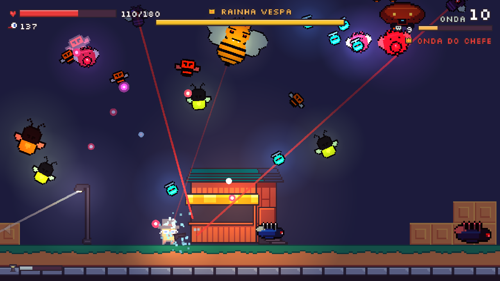
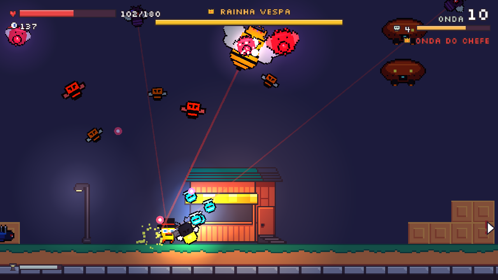

<div align="center">

# 🦆 Psycho Duck

**Um pato. Uma cartola. Uma pistola. E insetos demais.**

Roguelite de sobrevivência em ondas, em pixel art, feito em Godot 4 pela [Briba Studio](https://bribastudio.com).




</div>

## Sobre o jogo

É noite na cidade e a casinha do pato está cercada. Abelhas, vaga-lumes, drones e bichos bem piores chegam em ondas, e a cada dez delas a **Rainha Vespa** aparece para cobrar a conta. Você anda, pula entre plataformas, mira com o mouse e atira até não sobrar nada voando.

Entre uma onda e outra, o jogo é sobre escolhas: uma carta grátis por onda, uma loja a cada cinco e itens permanentes que ficam com você entre as runs.

### O que já tem

- **Combate de plataforma:** andar, pular (com pulo duplo), descer de plataformas, mira livre no mouse, críticos e números de dano.
- **7 inimigos** com silhueta e cor próprias (abelha, vaga-lume, Skimmer, Sniper, Bomber, Carrier e drone), versões **elite** e a **Rainha Vespa** a cada 10 ondas.
- **Progressão:** carta por onda, loja a cada 5 ondas, itens permanentes (óculos e cartola) e upgrades do poste de luz a partir da onda 10.
- **Arena que cresce** a cada 10 ondas, até a onda 30.
- **Juice:** squash & stretch, flash de dano, partículas, tremor de tela e cartas que pulam no hover.
- **Run salva** no início de cada onda, pausa, opções e skins desbloqueáveis.
- Trilha e **35 efeitos sonoros**, em português e inglês.

<div align="center">



</div>

## Controles

| Ação | Teclado e mouse |
|---|---|
| Andar | `A` / `D` ou `←` / `→` |
| Pular | `W`, `Espaço` ou `↑` |
| Descer da plataforma | `S` ou `↓` |
| Mirar | Mouse |
| Atirar | Clique esquerdo (segure) |
| Pausar | `Esc` |

## Rodando o projeto

1. Instale o [Godot 4.7](https://godotengine.org/download) (versão padrão, sem .NET).
2. Clone o repositório:
   ```bash
   git clone https://github.com/Pews-DEV/psycho-duck.git
   ```
3. No Godot, **Importar** e escolha o `project.godot`. Na primeira abertura ele importa os assets.
4. Aperte **F5** para jogar.

Para exportar, os presets de **Windows Desktop** e **Web** já estão em `export_presets.cfg` (é preciso instalar os export templates do Godot 4.7).

## Estrutura

```
autoload/      estado global, música, efeitos sonoros e configurações
scenes/
  player/      o pato, armas e acessórios
  enemies/     inimigos, elites e a Rainha Vespa
  projectiles/ tiros e ataques
  pickups/     orbes, cura e moedas
  game/        arena, ondas, câmera e iluminação
  ui/          menus, HUD, cartas e lojas (tudo a partir de UiStyle)
scripts/       efeitos e recursos compartilhados
assets/        sprites, fontes, shaders e áudio
localization/  textos em pt-BR e en
tests/         bots de balanceamento, vitrine de inimigos e capturas de tela
tools/         scripts Python que geram sprites, efeitos sonoros e textos
docs/          guia de design visual e checklist da demo
```

O guia [docs/DESIGN.md](docs/DESIGN.md) documenta a direção de arte, a paleta, as regras de pixel art e a interface. Vale ler antes de mexer em qualquer visual.

## Ferramentas de desenvolvimento

Todos rodam pelo Godot a partir da pasta do projeto:

```bash
# Bot que joga sozinho e gera um relatório de balanceamento
godot --path . res://tests/balance_bot.tscn

# Vitrine com todos os inimigos lado a lado
godot --path . res://tests/enemy_showcase.tscn

# Capturas de todas as telas da interface
godot --path . res://tests/ui_snapshots.tscn

# Cena caótica para thumbnail (sem gravar save)
godot --path . --resolution 1920x1080 res://tests/thumbnail.tscn -- --out=C:/pasta
```

Os sprites e os efeitos sonoros são gerados por código: veja `tools/make_sprites.py` e `tools/make_sfx.py`.

## Contribuindo

Issues e pull requests são bem-vindos, de correção de bug a ideia de inimigo novo. Para mudanças visuais, siga o [guia de design](docs/DESIGN.md); para mudanças grandes, abra uma issue antes para a gente conversar.

## Licença

- **Código** (`.gd`, `.py`, cenas e scripts): [MIT](LICENSE).
- **Arte, áudio, nome e marca** (sprites, música, efeitos sonoros, logo): [CC BY-NC 4.0](LICENSE-ASSETS.md). Pode estudar, remixar e usar em projetos não comerciais, com crédito. Para uso comercial, fale com a gente.
- **Fonte Silkscreen:** SIL Open Font License, em [assets/fonts/OFL.txt](assets/fonts/OFL.txt).
- Feito com [Godot Engine](https://godotengine.org) (MIT).

<div align="center">

Feito no Ceará pela **[Briba Studio](https://bribastudio.com)** 🦎

</div>
